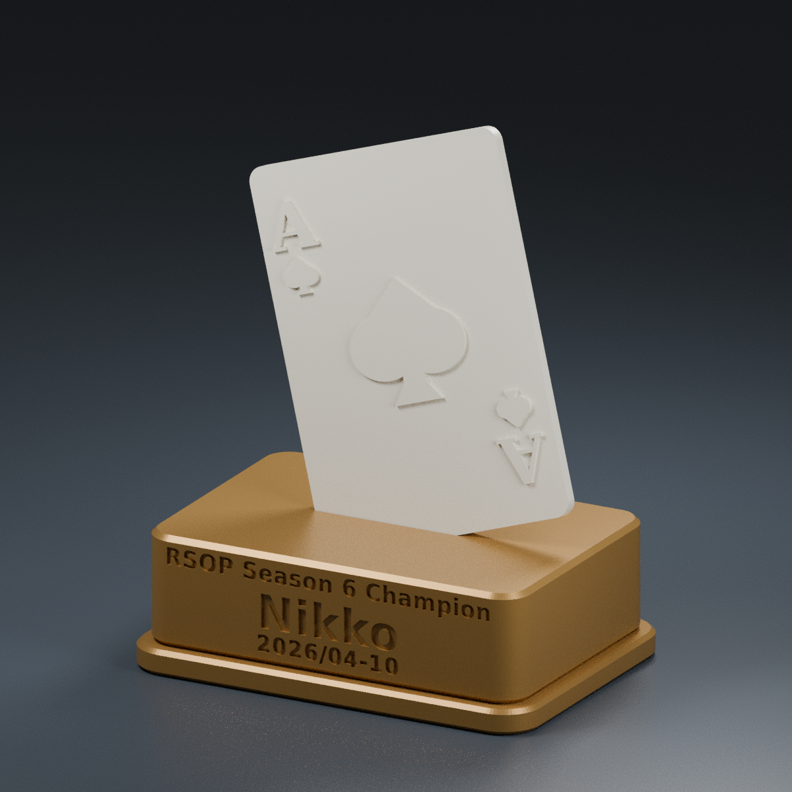

# Nikko ポーカートロフィー — Bambu Lab A1 mini

スペードのAが斜めに刺さる、2部品組み立て式のトロフィーです。
台座とカードを別々の単色フィラメントで印刷できます。AMSは不要です。
カード内のAとスートはカードと同じ色の浮き彫りです。
カード外周の枠線はなく、表面はAとスート以外をフラットにしています。

台座の彫り込みは、以下の3行をすべて中央揃えにしています。
「Nikko」を一番大きく、日付を小さく配置しています。
読みやすさを優先し、台座を高さ32 mm、実際の文字の高さを大会名約5.4 mm、Nikko約8.6 mm、日付約4.5 mmにしています。
日付は文字間を少し広げ、線も片側0.06 mmずつ太くしています。

```text
RSOP Season 6 Champion
Nikko
2026/04-10
```



## ダウンロード

**[印刷用データ一式（ZIP）](output/nikko_trophy.zip)** を開き、GitHubの「Download raw file（↓）」で保存してください。
解凍したフォルダの`output/base.stl`と`output/card.stl`をBambu Studioへ読み込みます。
文字の確認には`output/text_test.stl`、差し込みの確認には`output/fit_test.stl`を使います。

リポジトリ全体を取得する場合は、GitHubの「Code → Download ZIP」でも保存できます。

## ブラウザでプレビュー

`output/nikko_preview.html`をダウンロードし、Chrome、Edge、Safari等のブラウザで開いてください。
「完成画像」「回して見る」「部品ごと」を切り替えられます。
3D表示はドラッグで回転、ホイールや2本指で拡大縮小できます。
画像とモデルをファイル内に含むため、専用ソフトや外部通信は不要です。
3D表示にWebGLを使用します。対応していない場合も完成画像を確認できます。

## ファイル

| ファイル | 用途 | 印刷時の寸法 mm |
| --- | --- | --- |
| `output/base.stl` | 大会名・「Nikko」・日付の3行を彫り込んだ台座 | 100 × 70 × 32 |
| `output/card.stl` | スペードのA、文字とスートを0.8 mm浮き彫り | 63 × 88 × 3.8 |
| `output/fit_test.stl` | 台座と同じ差し込み溝の試し刷り | 60 × 30 × 14 |
| `output/text_test.stl` | 台座と同じ文字・彫りの深さ・印刷方向の試し刷り | 90 × 8 × 26 |
| `models/nikko_trophy.scad` | 寸法・角度・隙間を変更できるOpenSCAD原本 | — |
| `output/parts.png` | 部品の印刷方向の参考画像 | — |
| `output/nikko_preview.html` | 画像と回転可能な3Dモデルを含むブラウザ用プレビュー | — |
| `output/validation.json` | メッシュ検査と実測寸法の記録 | — |
| `output/text_metrics.json` | 文字の実寸と隙間の測定記録 | — |

完成時は約 **幅100 × 奥行70 × 高さ122.3 mm**。
カードは横に18°、後ろに10°傾き、下の角が10 mm入ります。
台座の文字は深さ0.8 mm、カード本体の厚さは3 mmです。
溝はカードの各側に0.25 mm、厚み方向の合計で0.5 mmの余裕があります。

## Bambu Studioでの印刷

1. プリンターは **Bambu Lab A1 mini / 0.4 mmノズル**を選択します。
2. STLを読み込みます。単位はmm、倍率100%のまま使用します。
3. カードは**平らな裏面が下、浮き彫りが上**。台座と試し刷り部品は底面が下です。STLは最初からこの向きです。
4. 標準PLAのプリセットを基準に、積層0.20 mm、壁3周、上下面5層、インフィル15%（Gyroid等）から始めてください。
5. サポートはOFFを想定しています。台座の溝と彫り文字をスライス後のプレビューで確認してください。
6. カードと試し刷り部品を先に印刷し、冷えてから差し込みを試します。カードの左下の角を、浮き彫り面が「Nikko」と同じ正面を向くように入れます。
7. はめ合いを確認できたら、台座を好みの色で印刷します。例：金色の台座＋アイボリーのカード。

台座の大会名と日付は小さい文字のため、台座は積層0.16 mmも推奨します。
スライス後のプレビューで文字が欠けずに表現されているか確認してください。
大会名の「i」の点と縦棒の間には、縦方向に約0.39 mmの隙間があります。
ここも積層0.16 mmで形が残ることを試し刷りで確認してください。

### 文字の試し刷り

`output/text_test.stl`を100%のサイズで、STLの向きのまま底面を下にして印刷してください。
同じPLA、積層0.16 mm、0.4 mmノズル、壁3周、インフィル15%を基準にしてください。
台座と同じ方向で文字を彫り込んだ小さな縦置きプレートです。必要に応じてブリムを付けてください。
大会名・名前・日付の読めること、数字の穴や文字同士の隙間が残ることを確認してから台座を印刷します。
文字が崩れた場合は、流量や温度などを使用する材料の推奨範囲で調整し、同じプレートで再確認してください。

カードと台座のSTLをそれぞれ別のプレート／別ジョブにすると、単色プリンターで色を替えて印刷できます。
`parts.png`は配置説明用で、A1 miniの1枚のプレートに全部を配置した画像ではありません。

## 組み立てと調整

- 溝の傾きに合わせ、カードの角をゆっくり差し込んでください。浮き彫り面が台座の「Nikko」側です。
- 個体差・材料・印刷設定で隙間が変わります。きつい場合は無理に押し込まず、溝やカード端のバリを軽く整えてください。
- 隙間を変更する場合は、OpenSCADの`clearance`（片側のmm）を0.05 mmずつ調整し、試し刷り→台座の順に再出力します。カードを含む全体の拡大縮小は不要です。
- ぐらつく場合は、はめ合いを調整するか、確認後にカード裏の差し込み部分を少量の適切な接着剤で固定してください。
- 写真のような黒い印字は含みません。Aとスートは立体で表現されます。必要なら印刷後に凸部を塗装できます。

## 再出力

OpenSCAD 2021.01以降とDejaVu Sans / DejaVu Serifフォントを使用します。

```sh
cd /workspace/print
bash scripts/export.sh
```

`part`を`assembly`にするとOpenSCADで組み立て状態を確認できます。
印刷には各部品のSTLを使用してください。
寸法・角度を変更するときは、溝の位置、台座の残り肉厚、文字と溝の干渉を再確認してください。
レンダリング・プレビュー・メッシュ検査は、`scripts/design.py`を通してCAD原本の寸法と組み立て位置を読み取ります。

## 確認した範囲

全STLの閉じたメッシュ、一体性、正の体積、法線方向、180 mm立方の造形範囲への収まりを検査済みです。
既定寸法で、組み立てたカードと台座の共通体積がないことをOpenSCADの交差演算で確認しました。
完成画像は同じSTLを使ったレンダリングです。実物写真ではありません。
**Bambu Studioでのスライスおよび実機印刷は未実施です。** はめ合いは試し刷りで確認してください。
